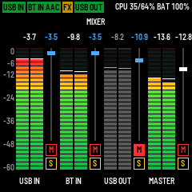
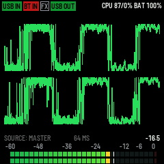
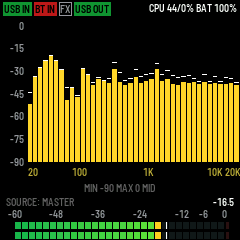
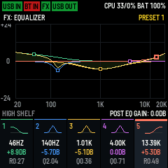
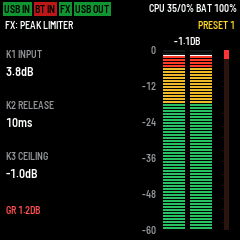

<h1 align="center">FM-1 Audio Router</h1>

  USB audio interface and Bluetooth audio receiver firmware for M-VAVE FM-1

  
  
  
  
  

  
  
  

# Features
- 2in/2out 16/44100 USB audio interface
- Bluetooth audio receiver with SBC, AAC, aptX, aptX HD and LDAC support
- FX chain of 5 bands parametric EQ and peak limiter with 8 presets
- Mixer
- MIDI controller functionality
- 3 Visualizers: meters, waveforms and 40-band spectrum

# Installation
1. Flash m-bootloader with [M-Flasher](https://github.com/jvitkauskas/m-flasher)
2. Turn off FM-1 and turn on while holding **REC** button
3. Flash [latest firmware](https://github.com/maxravedj/fm1-audio-router/releases/latest/download/fm1-audio-router-v0.4.0.fwsc) with M-Flasher

See additional [installation instructions](docs/INSTALL.md)

# Usage and controls
### USB audio
Plug your FM-1 to computer and it should be deteceted as class compliant 2in/2out audio interface. Incoming audio will be played through speaker or headphones output. You can send audio back to computer using USB OUT feature to have loopback or pass incoming bluetooth audio feed, raw or post-FX.

### Bluetooth
Enable bluetooth in settings and hold **OCT+** to enter or exit pairing mode. BT badge in status bar is yellow during pairing mode.

### FX chain
Hold **FX** button to enable or disable FX chain. Press **SEL** on specific FX screen to bypass that FX
- EQ: use **SELECT** to cycle through five bands and post-EQ gain, **ALGORITHM** to select filter type, **K1** for frequency, **K2** for gain or slope, **K3** for Q or resonance
- Peak limiter: use **K1** for input gain, **K2** for release, **K3** for ceiling

Use **PRESETS** knob to scroll presets. EQ and limiter have 8 preset slots each. Use **SAVE** to store changes to current preset.

### Mixer
Press **GLO** to open mixer. Use **K1**-**K3** to trim volumes on inputs and USB output. Use **MASTER** knob to control Master volume. Press **PLAY/STOP** to mute Master (works on any screen).
Use **F3**/**G3**/**A3**/**B3** to mute and **F4**/**G4**/**A4**/**B4** to solo.

### Settings
Press **EDIT** to open settings, use **SELECT** to scroll, **ALGORITHM** to change parameters and **SAVE** to save and apply settings.
- Bluetooth: enable/disable bluetooth
- Bluetooth codecs: **SEL** opens a checklist; **SELECT** scrolls, **SEL** toggles, **OCT−** cancels and **OCT+** confirms the draft. Press **SAVE** in Settings to apply it.
- Master waveform auto scale: automatically scale master waveform to achieve  always fat waveform
- USB OUT: send audio back to USB, select source here.

### MIDI controller
Enable MIDI in settings.
With USB connected, press **REC** to enter or leave MIDI mode. Encoders send absolute CCs (0–127) with gentle acceleration; keys send notes. **OCT−/OCT+** shift up to three octaves; press both to reset. **MASTER** keeps controlling audio.

### Visualizers
Press **HOME** to open visualizers screen and cycle through different visualizers.
 - Meters: no controls
 - Waveforms: **SELECT** knob scrolls through audio sources to visualize, use **K1** to choose window size
 - Spectrum: **SELECT** for source, **K1** and **K2** for minimum and maximum displayed dB, **K3** controls decay rate

AAC uses meters during playback to free decoder memory. LDAC supports stereo 44.1/48 kHz; spectrum yields memory first, and waveforms remain available when SRAM allows.

## Other usefull stuff

[Controls](docs/CONTROLS.md) · [Build, tests and releases](docs/BUILD.md) ·
[Architecture](docs/ARCHITECTURE.md) · [Debugging](DEBUG.md)

Built on fm1-base and felucca-bsp. See [credits](CREDITS.md) and
[licensing](LICENSING.md). Host tests cover DSP, protocols and UI behavior;
hardware RF interoperability, sound quality and CPU headroom need device checks.
